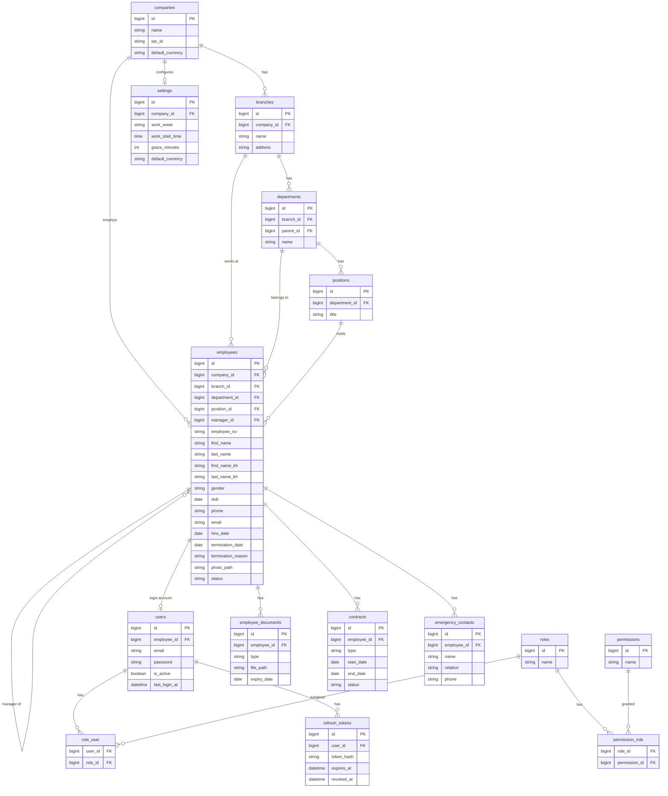
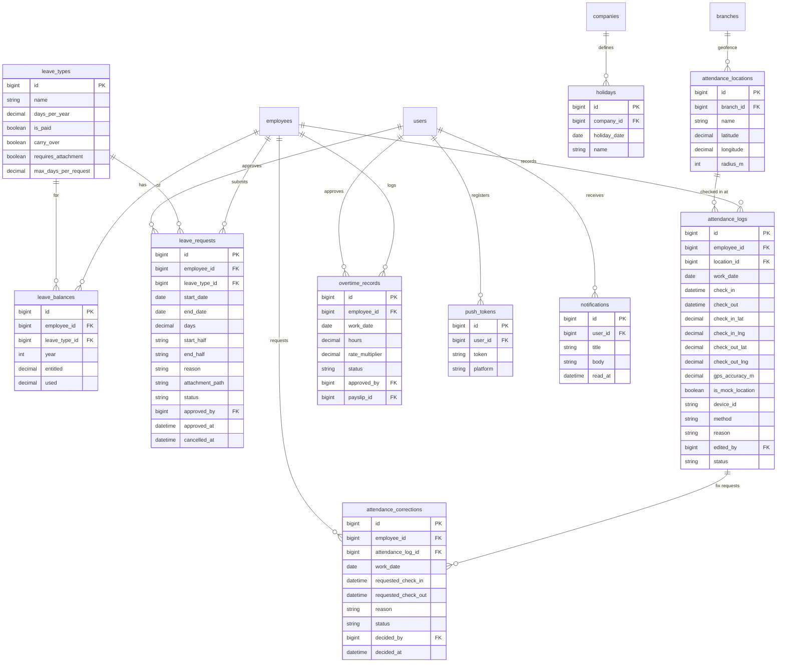
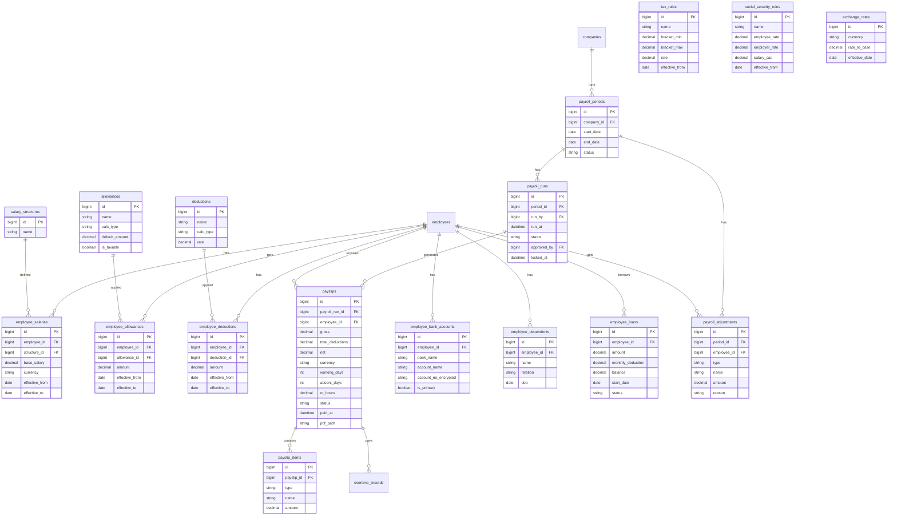

# HR System ERD (source of truth for types and mock data)

Target: PostgreSQL. GPS-only attendance. Every table also has created_at, updated_at (and deleted_at where useful). Money = decimal(15,2).

## 1. Auth, Organization, Employees

## 2. Leave, Attendance, Mobile

## 3. Payroll

## Design notes

- users.employee_id is nullable so pure admin accounts need no employee record.
- employees.manager_id (self-reference) drives manager approval and team scoping.
- Payslips are snapshots: payslip_items copy amounts at run time, so later salary changes never alter past payslips.
- leave_balances is one row per employee, leave type, and year.
- tax_rules and employee_salaries carry effective_from dates so rates have history.
- Attendance is one row per employee per day: add a unique constraint on (employee_id, work_date).
- Late / absent come from settings (work_start_time + grace_minutes), not shifts. Absent = working day with no check-in and no approved leave.
- device_id on attendance_logs is information only; check-ins are never blocked by device.
- approved_by, run_by, decided_by, edited_by all reference users.
- Removed for now: shifts, audit_logs, attendance_devices, attendance_punches, employee_devices.
- PostgreSQL: use timestamptz (UTC) and compute work_date in Asia/Phnom_Penh; numeric(15,2) for money; CHECK constraints or enums for statuses.
- Indexes: attendance_logs(employee_id, work_date), leave_requests(employee_id, status), payslips(employee_id, payroll_run_id).
- Encrypt employee_bank_accounts.account_no_encrypted and restrict who can read it. Confirm tax and NSSF rules with an accountant before coding them.
